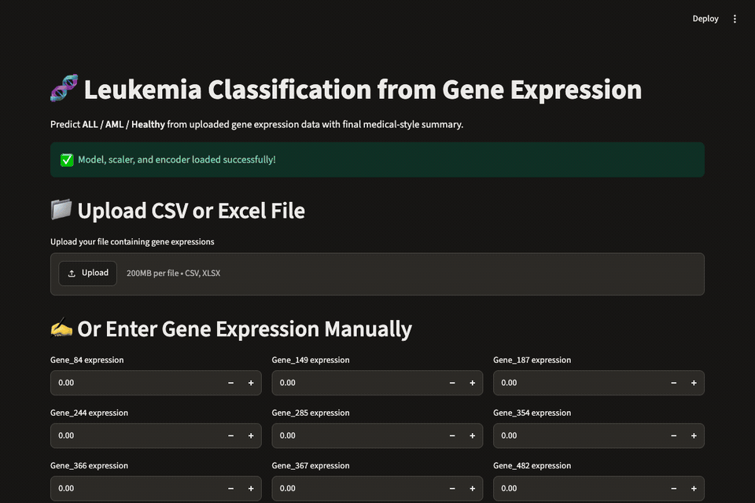
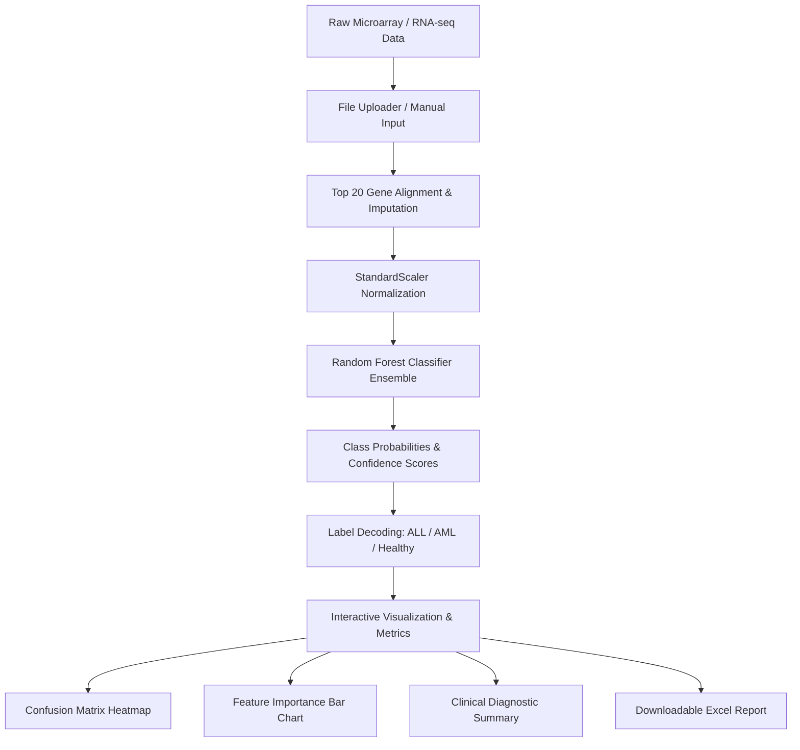

# 🧬 Leukemia Classifier from Gene Expression Profiles

[](https://www.python.org/)
[](https://streamlit.io/)
[](https://scikit-learn.org/)
[](https://opensource.org/licenses/MIT)

An interactive clinical machine learning web application that predicts **Acute Lymphoblastic Leukemia (ALL)**, **Acute Myeloid Leukemia (AML)**, or **Healthy** bone marrow gene expression patterns from microarray and RNA-seq gene expression profiling data.

Built with **Streamlit**, **scikit-learn**, **Pandas**, **Seaborn**, and **Joblib**.

---

## 🎬 Sneak Peek



---

## 🌟 Key Features

- **📁 High-Throughput Batch Upload**: Upload CSV or Excel (`.xlsx`) datasets containing microarray or RNA-seq gene expression values.
- **🧬 Top-20 Gene Biomarker Extraction**: Uses feature-selected biomarker genes (such as *Zyxin*, *Macmarcks*, *C-myb*, *FAH*, etc.) critical for distinguishing leukemia subtypes.
- **🎯 Multi-Class Subtype Classification**: Classifies samples into:
  - **ALL** (Acute Lymphoblastic Leukemia)
  - **AML** (Acute Myeloid Leukemia)
  - **Healthy** (Normal gene expression baseline)
- **🩺 Automated Medical Diagnostic Declaration**: Aggregates batch results, computes mean confidence percentages, and outputs a clinical-style verdict.
- **📊 Interactive Model Evaluation**:
  - Automatically detects ground-truth labels if present (`Diagnosis` column).
  - Displays classification metrics (Precision, Recall, F1-Score).
  - Generates confusion matrix heatmaps.
- **📈 Gene Importance Interpretability**: Dynamic feature importance bar plots showcasing the top contributing biomarkers based on the underlying Random Forest ensemble.
- **✍️ Manual Single-Sample Predictor**: Interactive sliders/number inputs for rapid hypothesis testing and single-patient scoring without file uploads.
- **📥 Diagnostic Export**: Download batch prediction results and confidence scores as a formatted Excel spreadsheet (`.xlsx`).
- **🔄 In-App Model Fine-Tuning**: Retrain and update the active model on newly uploaded and labeled laboratory datasets directly through the UI.

---

## 🏗️ Architecture & Pipeline



---

## 📂 Repository Structure

```plaintext
leukemia-classifier/
├── app.py                      # Main Streamlit web application & UI logic
├── best_model.pkl              # Pre-trained Random Forest classifier
├── scaler.pkl                  # Fitted StandardScaler for gene expression values
├── label_encoder.pkl           # LabelEncoder mapping classes (ALL, AML, Healthy)
├── top_genes.json              # List of the 20 most discriminative biomarker genes
├── requirements.txt            # Python dependencies
├── sample_data/
│   └── sample_leukemia_data.csv # Example gene expression dataset for testing
└── docs/
    └── sneak-peek.gif          # Application preview walkthrough
```

---

## 🚀 Getting Started

### Prerequisites

Ensure you have **Python 3.10+** and `pip` installed.

### Installation

1. **Clone the repository:**
   ```bash
   git clone https://github.com/vkn-can-code/leukemia-classifier.git
   cd leukemia-classifier
   ```

2. **Create and activate a virtual environment (optional but recommended):**
   ```bash
   python3 -m venv venv
   source venv/bin/activate  # On Windows: venv\Scripts\activate
   ```

3. **Install dependencies:**
   ```bash
   pip install -r requirements.txt
   ```

### Running the Application

Launch the Streamlit dashboard:

```bash
streamlit run app.py
```

The application will start and open automatically in your browser at `http://localhost:8501`.

---

## 🧪 Testing with Sample Data

A pre-formatted sample dataset is included in `sample_data/sample_leukemia_data.csv`:
1. Open the web interface.
2. Under **"Upload CSV or Excel File"**, upload `sample_data/sample_leukemia_data.csv`.
3. The app will immediately display:
   - Sample count and feature breakdown.
   - Ground-truth evaluation accuracy and classification report.
   - Confusion matrix heatmap.
   - Diagnostic declaration summary.
   - Top-20 gene importance graph.
   - Option to download the prediction report as an `.xlsx` file.

---

## 🔬 Biomarker Genes

The classifier evaluates expression levels across established oncogenomic markers, including:
- **M55150_at** (FAH / Fumarylacetoacetate)
- **U50136_rna1_at** (Leukotriene C4 synthase)
- **X95735_at** (Zyxin)
- **M16038_at** (Lyn tyrosine kinase)
- **M23197_at** (CD33 antigen)
- And other key discriminative genes identified in leukemia profiling benchmarks.

---

## 👤 Author

**Vivek K Nair**
- GitHub: [@vkn-can-code](https://github.com/vkn-can-code)
- Portfolio / Projects: [github.com/vkn-can-code](https://github.com/vkn-can-code)

---

## 📄 License

This project is open-source and available under the [MIT License](LICENSE).
